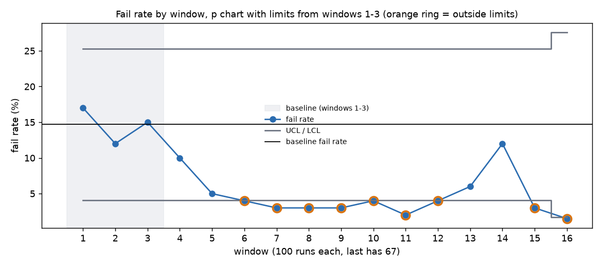
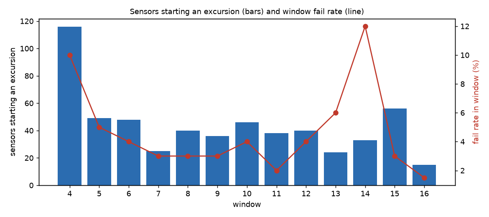
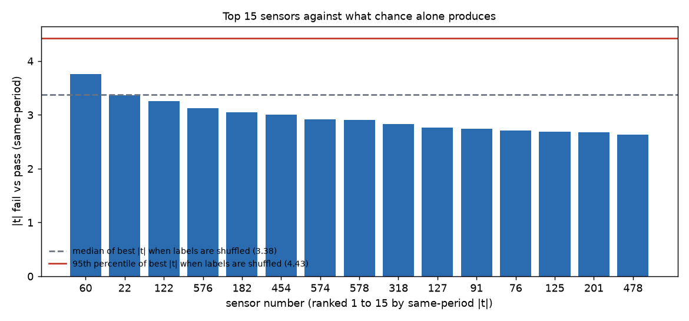
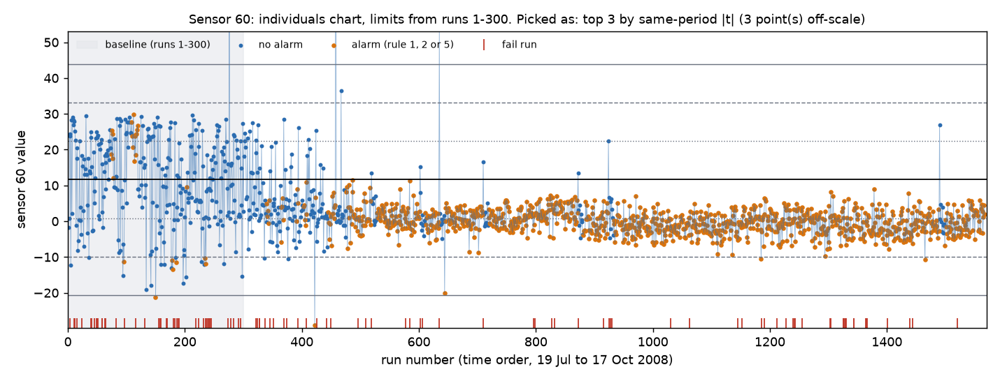

# secom-spc: statistical process control on public semiconductor data

A small SPC project on the public UCI SECOM dataset: sensor readings from a semiconductor production line with a pass/fail result for every run. It builds control charts with limits from an early baseline, applies written alarm rules, tracks yield by time window, ranks sensors by how well they separate pass from fail, and keeps a simple corrective-action-style log. The analysis is in DuckDB SQL; Python loads the data, draws the charts and cross-checks every result.

The main findings are modest, and the write-up says so. The fail rate fell from about 15% in the baseline to mostly 2 to 6% afterwards. Most sensor excursions were level shifts that persisted. And no single sensor separated fail from pass better than a label-shuffle test says chance would.

- Data: UCI Machine Learning Repository, "SECOM" (McCann and Johnston, donated 2008): https://archive.ics.uci.edu/dataset/179/secom. 1,567 runs, 590 anonymised sensor columns, pass/fail label, timestamps (19 Jul to 17 Oct 2008). Check the UCI page for the licence. The raw data is not in this repo; `fetch_data.py` downloads it.
- A companion SQL project on review data: https://github.com/JozXO/steam-sql (same style: queries, check table, study guide).

## What is in here

| Path | What it is |
|---|---|
| `RULES.md` | The windows, limits and alarm rules, committed before any chart or ranking was produced, plus a short list of what was added after seeing results |
| `queries/build/` | 8 SQL files that build the tables: windows, usable sensors, control limits, alarm flags, within-window z-scores, separation scores, split-half scores, CAPA log |
| `queries/` | 11 numbered SQL files, one question each, with plain-English comments |
| `run_all.py` | Builds the database, runs every query, recomputes the results independently with pandas and numpy, prints a check table |
| `permutation_check.py` | Label-shuffle test for the sensor ranking |
| `make_charts.py` | Draws the charts in `charts/` from the SQL tables |
| `fetch_data.py`, `load_data.py`, `pipeline.py` | Download and shape-check the data, load it into DuckDB, run the SQL files |
| `check_learn.py` | Re-runs the exercise answers in `LEARN.md` so the study guide matches the data |
| `LEARN.md` | Study guide: terms, each step line by line, interview sentences, 5 exercises with answers |
| `check_table.md` | The full check table from the latest run |

## What the queries show

SQL used: `GROUP BY` and `HAVING`, CTEs, window functions (`LAG`, `RANK`, named windows with `ROWS BETWEEN` frames for the alarm rules, running min, max, count and sum), `FILTER` aggregates, inner and left joins, `NOT EXISTS`, `CASE`, medians, variances and correlations.

| Query | Question |
|---|---|
| Q1 | How many runs and fails, and what is the fail rate by week? |
| Q2 | How many of the 590 sensors can be charted at all, and why do the others drop out? |
| Q3 | Do the limits behave as theory says on the baseline they were built from? |
| Q4 | How many alarm points per window? |
| Q5 | Fail rate by window as a p chart with limits from the baseline |
| Q6 | Which sensors separate fail from pass best? (same-period Welch t, with raw t and AUC) |
| Q7 | Does that ranking hold in the second half of the data? |
| Q8 | Which four sensors are charted? (rule fixed in advance) |
| Q9 | CAPA-style table: the largest flagged excursions, whether the next window recovered |
| Q10 | CAPA summary: how many excursions recovered, persisted, or had no next window |
| Q11 | In which windows did many sensors start an excursion at once? (added after seeing Q9 and Q10, marked as exploration) |

## How to run it

```bash
pip install -r requirements.txt
python fetch_data.py         # downloads the three UCI files into data/raw/ and checks the shape
python run_all.py            # builds secom.duckdb, runs the queries, prints the check table
python run_all.py --show     # also prints every query result
python make_charts.py        # redraws the charts in charts/
python check_learn.py        # checks the exercise answers in LEARN.md
```

Python 3.10 or later. About 15 seconds for `run_all.py`. You can also open `secom.duckdb` in the DuckDB command line and paste any file from `queries/`.

## The method in short

All of this was written down in `RULES.md` before any chart or ranking was calculated.

- **Windows:** 100 consecutive runs; the first 300 runs (3 windows) are the baseline, everything after is monitoring.
- **Charts:** Shewhart individuals charts. Centre line = baseline mean. Sigma = average moving range / 1.128. Limits = centre plus or minus 3 sigma.
- **Alarm rules:** Nelson rule 1 (a point beyond 3 sigma), rule 2 (9 in a row on one side of the centre line) and rule 5 (2 of 3 beyond 2 sigma on the same side).
- **Which sensors:** 415 of 590 are usable (measured in 90%+ of runs, not constant, at least 10 different values).
- **Ranking:** Welch t on fail vs pass, calculated inside each window so slow drift cannot fake a link; AUC as a second view; a label-shuffle test as the yardstick against chance.
- **CAPA-style log:** a flagged excursion is one sensor in one window with 3 or more Rule 1 points; "recovered" means the next window has fewer than 3.

## Results

All numbers below are in the check table, which compares each SQL result with an independent recomputation from the raw files.

**Yield.** The baseline fail rate is 14.7% (44 fails in 300 runs). Nine of the 13 monitoring windows are below the lower p chart limit; none is above the upper limit. Window 14 (4 to 7 Oct) rises to 12% before dropping to 3%.



**The limits are tight for these sensors.** On the baseline data they were fitted from, Rule 1 alarms 2.84% of points where theory for stable, normal data says about 0.27%. Rule 2 alarms 11.1% (theory about 0.4%) and Rule 5 2.6% (about 0.2%). The median limit sigma is 0.82 of the plain baseline standard deviation, so many sensors drift or move in steps even inside the baseline. Alarm rates then climb to 5 to 6% (Rule 1) by the last windows.

**Excursions mostly persist.** Of 1,593 flagged sensor-windows, 1,027 persist into the next window, 464 recover and 102 have no next window. Many sensors moved to a new level and stayed there. 116 sensors have an excursion in window 4 and 56 start one in window 15, straight after the 12% fail-rate window.



**No sensor beats chance.** The best same-period |t| is 3.76 (sensor 60). With the pass/fail labels shuffled inside windows (500 shuffles, seed 2008), the best |t| over 415 sensors has a median of 3.38 and a 95th percentile of 4.43. No sensor is above the 95th percentile. Correlation between first-half and second-half scores is 0.14. Of the first-half top 10, only sensors 60 and 22 stay near the top with the same sign in the second half.



**Charted sensors** (picked by a rule fixed in advance): the top 3 by separation, sensors 60, 22 and 122, plus sensor 137, the quietest in monitoring, for comparison.



The other three are in `charts/`.

### Check table (excerpt)

45 of 45 checks match. The full table is in [check_table.md](check_table.md).

| Query | Check | Independent | SQL result | Match |
|---|---|---|---|---|
| Q1 | Runs | 1,567 | 1,567 | yes |
| Q1 | Fail runs | 104 | 104 | yes |
| Q2 | Sensors: usable | 415 | 415 | yes |
| Q3 | Baseline alarm rate, Rule 1 (%) | 2.8368 | 2.84 | yes |
| Q4 | Windows where Rule 1, 2, 5 % and sensors-with-Rule-1 all match | 16 of 16 | 16 of 16 | yes |
| Q5 | Windows below the lower limit | 9 | 9 | yes |
| Q6 | Sensor 60: t_same | 3.7566 | 3.76 | yes |
| Q6 | All 415 sensors: largest difference in t_same, t_raw, AUC (under 1e-8) | < 1e-8 | < 1e-8 | yes |
| Q7 | Correlation of t between the two halves, all sensors | 0.1355 | 0.1355 | yes |
| Q10 | Excursions: persists | 1,027 | 1,027 | yes |
| Q11 | Sensors starting an excursion, windows 4 to 16 | [116, 49, 48, 25, 40, 36, 46, 38, 40, 24, 33, 56, 15] | same | yes |

The label-shuffle test uses a random seed and has no second implementation, so it is not in the check table. It is printed by `run_all.py`.

## Limits

- **Public data, anonymised sensors.** The 590 columns have no names, units or process steps, so no sensor can be tied to a tool, step or recipe. A shift in a sensor shows that something changed, not what.
- **No claim of fab experience.** This is a method exercise on a public dataset. It is not work on a real production line.
- **The baseline was not calm.** The first 300 runs hold the highest fail rate in the data, and by the stated rules many sensors were not in control inside it. Limits fitted there are tight, so the monitoring alarm counts are high. A re-fit on a calmer stretch or with a robust method would change the numbers. I did not do that.
- **The windows and baseline were chosen after seeing the weekly fail rate**, though before any sensor was charted. `RULES.md` says so.
- **Ranking is candidates, not causes.** With 415 sensors and 104 fails, some sensors look good by luck. The shuffle test and the split-half check say the ranking is weak. Nothing here shows that any sensor caused a failure.
- **Not done:** multivariate methods (for example PCA-based charts), a multi-variable model of failures, and a dashboard.

## How this was built

Drafted with Claude Code as a coding partner. LEARN.md explains each step so I can explain and rewrite it myself.

*(Wording to be approved by the author before publishing.)*
